# ServerPulse ER Diagram

Entity-relationship diagram for the SQLite schema in
[database-schema.md](database-schema.md).

Includes migrations `0001_initial`, `0002_users`, and `0003_monitoring`.
`schema_migrations`, created by the migration runner, is an independent tracking
table and is omitted from this domain diagram.

Implemented runtime entities are `users`, `hosts`, `collector_credentials`,
`monitoring_samples`, `process_samples`, and `monitoring_receipts`. The log,
service, and alert entities are schema-ready for planned functionality;
`user_tokens` is reserved for a future opaque-token flow, not current JWT sessions.

```mermaid
erDiagram
    hosts ||--o{ collector_credentials : "authenticates"
    hosts ||--o{ ingestion_receipts : "submits"
    hosts ||--o{ monitoring_samples : "reports resources"
    monitoring_samples ||--o{ process_samples : "captures processes"
    hosts ||--o{ monitoring_receipts : "deduplicates monitoring"
    monitoring_samples |o--o{ monitoring_receipts : "acknowledges"
    hosts ||--o{ log_sources : "collects from"
    hosts ||--o{ log_events : "owns"
    log_sources ||--o{ log_events : "produces"
    hosts ||--o{ monitored_services : "runs"
    monitored_services |o--o{ log_events : "associated with"
    monitored_services ||--o{ service_state_changes : "transitions"
    alert_rules ||--o{ alerts : "raises"
    monitored_services |o--o{ alert_rules : "watched by"
    log_sources |o--o{ alert_rules : "watched by"
    hosts |o--o{ alert_rules : "machine metric rules"
    monitored_services |o--o{ alerts : "about"
    log_sources |o--o{ alerts : "about"
    hosts |o--o{ alerts : "machine alerts"
    users ||--o{ user_tokens : "holds"

    hosts {
        INTEGER id PK
        TEXT name UK
        TEXT platform "windows | linux"
        TEXT deployment_type "localhost | wsl | external"
        TEXT wsl_distro "nullable"
        INTEGER enabled
        INTEGER long_running_seconds "default 3600"
        TEXT last_heartbeat_at
        TEXT collector_status_json "nullable"
        TEXT created_at
    }

    collector_credentials {
        INTEGER id PK
        INTEGER host_id FK
        TEXT token_digest UK
        TEXT created_at
        TEXT revoked_at "nullable"
    }

    monitoring_samples {
        INTEGER id PK
        INTEGER host_id FK
        TEXT sampled_at
        TEXT received_at
        REAL cpu_percent
        INTEGER memory_total_bytes
        INTEGER memory_available_bytes
        INTEGER memory_used_bytes
        REAL memory_percent
        INTEGER process_count
        INTEGER denied_count
        INTEGER vanished_count
        INTEGER long_running_count
        INTEGER zombie_count "null on Windows"
    }

    process_samples {
        INTEGER sample_id PK, FK
        INTEGER pid PK
        TEXT create_time "nullable"
        TEXT name "nullable"
        TEXT status "nullable"
        REAL cpu_percent "nullable until measured"
        INTEGER rss_bytes "nullable"
        REAL memory_percent "nullable"
        REAL runtime_seconds "nullable"
        INTEGER long_running "nullable"
        INTEGER zombie "null on Windows"
        INTEGER access_denied
    }

    monitoring_receipts {
        INTEGER host_id PK, FK
        TEXT batch_id PK
        TEXT payload_digest
        INTEGER sample_id FK "nullable after retention"
        TEXT accepted_at
    }

    ingestion_receipts {
        INTEGER id PK
        INTEGER host_id FK
        TEXT batch_id
        TEXT batch_type "logs | services"
        TEXT payload_digest
        TEXT response_json
        TEXT committed_at
    }

    log_sources {
        INTEGER id PK
        INTEGER host_id FK
        TEXT source_type "windows_eventlog | journald | auditd | file"
        TEXT category "system | application | security | audit"
        TEXT channel "System, Application, Security, journal, file path"
        TEXT selection_json "provider, unit, or parser configuration"
        INTEGER enabled
        TEXT acknowledged_checkpoint_json
        TEXT last_status "never_run | ok | unavailable | error"
        TEXT last_error
        TEXT last_attempt_at
        TEXT last_success_at
    }

    log_events {
        INTEGER id PK
        INTEGER source_id FK
        INTEGER host_id FK
        INTEGER service_id FK "nullable"
        TEXT source_record_id
        TEXT category
        TEXT occurred_at "UTC"
        TEXT collected_at "UTC"
        TEXT received_at "UTC"
        TEXT timestamp_quality "native | fallback"
        TEXT severity "debug | info | warning | error | critical | unknown"
        TEXT native_severity "nullable"
        INTEGER event_id "nullable, e.g. Windows Event ID"
        TEXT provider "nullable"
        TEXT message
        TEXT raw_json "nullable"
    }

    monitored_services {
        INTEGER id PK
        INTEGER host_id FK
        TEXT service_name
        TEXT display_name
        INTEGER enabled
        INTEGER expected_running
        TEXT current_state "running | stopped | failed | paused | transitional | unknown"
        TEXT native_state "nullable"
        INTEGER last_observation_sequence
        TEXT last_status "never_run | ok | unavailable | error"
        TEXT last_checked_at
        TEXT last_error
    }

    service_state_changes {
        INTEGER id PK
        INTEGER service_id FK
        INTEGER observation_sequence
        TEXT previous_state
        TEXT new_state
        TEXT changed_at
        TEXT error_message
    }

    alert_rules {
        INTEGER id PK
        TEXT name
        TEXT rule_type "service_failure | error_burst | machine_metric"
        INTEGER service_id FK "service_failure only"
        INTEGER source_id FK "error_burst only"
        INTEGER host_id FK "machine_metric only"
        TEXT metric "machine_metric only"
        TEXT process_name "process metrics only"
        INTEGER threshold_count "error_burst only"
        INTEGER window_minutes "error_burst only"
        REAL threshold "machine_metric only"
        INTEGER sustained_minutes "machine_metric only"
        INTEGER enabled
        TEXT created_at
        TEXT updated_at
    }

    alerts {
        INTEGER id PK
        INTEGER rule_id FK
        INTEGER service_id FK "nullable"
        INTEGER source_id FK "nullable"
        INTEGER host_id FK "nullable, machine alerts"
        TEXT status "open | acknowledged | resolved"
        TEXT message
        REAL value "machine alerts"
        TEXT triggered_at
        TEXT event_window_start "nullable"
        TEXT event_window_end "nullable"
        INTEGER historical
        TEXT acknowledged_at
        TEXT resolved_at
    }

    users {
        INTEGER id PK
        TEXT username UK
        TEXT password_hash
        INTEGER is_admin "0 | 1"
        INTEGER enabled
        TEXT created_at
        TEXT last_login_at "nullable"
    }

    user_tokens {
        INTEGER id PK
        INTEGER user_id FK
        TEXT token_digest UK
        TEXT capability "read | admin"
        TEXT created_at
        TEXT expires_at
        TEXT last_used_at "nullable"
        TEXT revoked_at "nullable"
    }
```

Monitoring samples own their process rows. Deleting a sample cascades to those
rows but sets its receipt's `sample_id` to NULL, preserving duplicate acknowledgement.
Process identity across snapshots is host + PID + creation time. Nullable metrics
mean unknown; Windows zombie values are not applicable. History/retention and
authentication behavior are detailed in the [table guide](tables.md).
