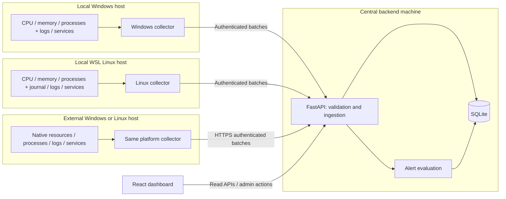

# ServerPulse - High-Level Design

Updated: 2026-11-14. This document contains both implemented paths and the target
design. Authentication, resource/process monitoring, Windows System/Application
and Linux journald ingestion, current service inventory, and machine-metric alerts
are implemented. Additional log sources, service transition history,
service/log-based alerts, and reporting remain proposed. See the
[LLD and function flows](LLD.md) for implementation details and boundaries; the
[roadmap](../../roadmap.md) is the consolidated completion checklist.

## 1. Purpose

ServerPulse is a college-project monitoring dashboard for Windows and Linux.
It currently monitors machine resources and processes; existing logs, selected
OS services, and alerts are the next planned operational data paths.

Development starts with the local Windows computer and a local WSL distribution.
The same architecture must support external Windows and Linux servers without a
separate collection mechanism or a database change for every new machine.

### Scope

- Existing system, application, and available security/authentication logs.
- Optional Linux audit logs where the environment supports them.
- Selected Windows and Linux service states and state-change history.
- CPU percentage, memory usage, and all visible processes on registered Windows
  and Linux machines, including runtime classification and Linux zombie detection.
- Host connectivity, source collection status, log search, and basic alerts.
- Local and remote hosts using the same ingestion APIs.

### Outside the initial scope

- Enterprise-scale ingestion, distributed databases, and message brokers.
- A full SIEM, anomaly detection, or automatic service remediation.
- General-purpose remote command execution, WinRM polling, or plaintext server
  credential storage. SSH support is limited to installing and controlling the
  ServerPulse collector on Linux.
- Email/SMS notifications, multi-tenant access, and advanced user roles.

## 2. Design decisions

| Area | Decision |
| --- | --- |
| Frontend | Existing React and TypeScript application |
| Backend | Existing Python/FastAPI application |
| Central database | SQLite on the backend machine's local disk |
| Collection | Lightweight Python collector running on each monitored host |
| Scheduling | Collectors poll locally, then push batches to the backend |
| Planned log/service access | PowerShell on Windows; journalctl, systemctl, and existing files on Linux |
| Resource/process access | psutil on Windows and Linux, running on the monitored host |
| Deployment | One backend instance; Windows and WSL are the first two hosts |
| External hosts | Same collector with HTTPS or a managed SSH reverse tunnel |
| Credentials | Per-host collector tokens; user access/refresh JWTs and enabled-admin checks |
| Live updates | Dashboard polls APIs initially; no WebSocket requirement |

No separate collector framework, cloud service, Docker deployment, or database
server is required. A collector can run in a terminal during development and later
under Task Scheduler or a systemd service.

## 3. Architecture

The diagram shows the shared target architecture. Resource/process ingestion,
Windows System/Application and Linux journald adapters, current service inventory,
and machine-metric alert evaluation exist today. See the LLD for remaining gaps.

Only the backend opens the central SQLite database. Collectors never connect to
it directly. WSL is registered as a separate Linux host even though it runs on the
same physical computer.

## 4. Components and responsibilities

### 4.1 Collector

The current `collect-host` implements psutil resource/process sampling, Windows
System/Application and Linux journald collection, and Windows/systemd service
inventory. It keeps a separate pending batch for each collection type and
advances log checkpoints only after acknowledgement. Additional log sources and
service transition history remain future work.

- Read the implemented platform sources using platform-specific adapters;
  configurable source selection remains future work.
- Convert native records to the common event format.
- Poll selected services and report collection failures explicitly.
- Maintain source checkpoints and a small persistent pending-batch spool.
- Send logs, service observations, source status, and heartbeats to FastAPI.
- Retry transient delivery failures without losing batch identity.

Share scheduling, normalization, transport, configuration, and retry code between
platforms. Keep Windows and Linux extraction code separate.

The current collector takes the backend URL, token, state-file path, interval,
and optional log flag from its command line/environment. Configurable source and
service selections remain future work. Secrets must not be committed to Git or
included in diagnostic logs.

### 4.2 Backend

Resource and log ingestion/querying, current service inventory, machine-metric
alert evaluation, and account/host administration exist today. Service transition
history, service/log-based alert evaluation, and alert acknowledgement remain
planned.

- Authenticate collectors and validate their ownership of sources and services.
- Validate batch sizes, event fields, timestamps, and state values.
- Store normalized events and latest service observations; transition history
  remains future work.
- Deduplicate retries and track host/source freshness.
- Evaluate simple alert rules and expose paginated query APIs.
- Provide administrator actions for host registration and alert acknowledgement.

### 4.3 Dashboard

Implemented screens include login/registration, account/session information, admin
account management, API/database health, and Machines. The Machines view includes
resource/process data, log search, service inventory, and machine-metric alerts.
Reports and richer service/log alert workflows remain planned.

- Overview: registered hosts, fresh/stale collectors, service issues, active alerts.
- Hosts: platform, connectivity, latest heartbeat, and per-source errors.
- Machines: CPU/memory history, searchable process snapshots, per-process history,
  informational long-running classification, and Linux zombie visibility.
- Logs: host, category, severity, source, service where available, keyword, and time filters.
- Services: latest observed state and observation age.
- Alerts: rule, affected host/source/service, evidence, and acknowledgement.

Display empty results separately from collection errors. Do not present a stale
observation as a current healthy state.

## 5. Log sources and extraction

### Resource and process monitoring

Implemented resource monitoring is separate from the proposed log/service
collection adapters. Each registered host runs `collect-host` locally; registration
and token rotation are administrator-only, and dashboard queries require an enabled
user account. Collectors authenticate with one-time, host-bound credentials, not
administrator tokens. Windows, WSL, and external hosts use the same path.

The collector uses psutil for one-second host CPU measurements, total/available
memory, and all visible processes. Per-process CPU is normalized across logical
CPUs using deltas between observations; its first value is unknown. Process
identity is PID plus creation time, preventing PID reuse from merging history.
RSS is process memory, while host used memory is total minus available.

Long-running means elapsed lifetime at least a configurable per-host threshold
(default one hour), informational only. Linux `zombie` is detected from native
process state; Windows reports not applicable. A long-lived service is not
automatically unhealthy. Permission-denied partial rows and disappeared-process
counts keep visibility limitations explicit. No synthetic data or process
termination is required.

Resource snapshots have their own atomic ingestion and receipt tables. A collector
persists one pending snapshot and retries it before sampling again. This bounds
outage storage, but does not capture an offline timeline. Limits are 20,000
processes and 16 MiB per upload. A delayed batch cannot overwrite newer observations.
Physical snapshot retention is 24 hours, pruned per host on subsequent ingestion;
receipts survive seven days. Time-based queries exclude expired history. Offline
hosts retain visibly stale last samples until ingestion resumes.

The dashboard polls at ten-second intervals, offers filtering/sorting/pagination,
and shows per-process history. Successful snapshot receipt acts as heartbeat;
60 seconds without receipt marks the host offline. No sample means unknown,
not zero CPU/memory. Threshold changes apply to new observations.

Existing log and service collection below remains a separate planned capability.

| Category | Windows | Linux / WSL |
| --- | --- | --- |
| System | System Event Log using Get-WinEvent | systemd journal, where available |
| Application | Application Event Log from installed software; existing application log files where available | Existing installed-application journal records or log files |
| Security/authentication | Security Event Log | Authentication-related journal records or configured auth log file |
| Audit | Security events enabled by audit policy | auditd records only after verifying environment support |

### Windows considerations

- Read System and Application channels. Security is out of scope for this collector.
- Query incrementally by channel and record ID, with bounded batch sizes.
- Detect channel clearing/reset and record a collection-gap warning.

### Linux and WSL considerations

- Verify systemd/journald availability before enabling journal collection.
- Read journal records as JSON and resume using journal cursors.
- WSL networking, logging persistence, and systemd availability depend on configuration.
- Authentication files such as `/var/log/auth.log` are not guaranteed to exist.
- Do not assume auditd works just because a distribution is Linux or systemd is enabled.
- Report unsupported or permission-denied sources as unavailable; do not fabricate records.
- Configure non-overlapping journal/file selection where possible to avoid collecting
  the same event twice through different sources.

### Existing application logs

Collect records already produced by installed software; no custom application,
demo log generator, or synthetic application file is required. On Windows, start
with the Application Event Log. On Linux/WSL, discover installed applications
that write to journald or existing files, such as a package manager's logs.

Enable only sources that actually exist and have readable, documented formats.
An application need not be running now to have historical records. If WSL has no
suitable application source, show that limitation rather than generating events
to fill the dashboard. Use configured source/provider mappings to distinguish
application records from system and authentication records in a shared journal.

## 6. Collection and delivery flow

### Current resource path

The collector samples locally at a nominal ten-second interval, atomically saves
one pending resource snapshot, and pushes it with a UUID. Only after a committed
acknowledgement does it delete the pending file. On delivery failure it retries
that snapshot before sampling again; it does not collect an unlimited outage
timeline. Actual intervals can exceed ten seconds on busy hosts because sampling
and delivery never overlap.

Uploads are limited to 20,000 processes and 16 MiB. Duplicate IDs require identical
validated payloads. New committed snapshots update receipt-time heartbeat; after
60 seconds the host is offline. Snapshot freshness is shown independently.
Process CPU is unknown on first observation or when normalization is unavailable.
History queries cover 24 hours; pruning runs on subsequent host ingestion, with
deduplication receipts retained seven days.

### Implemented log path

`collect-host --logs` reads Windows System/Application events (`Get-WinEvent`,
EventRecordID checkpoints, 100 records per channel) and Linux journald
(`journalctl --output=json`, cursor checkpoints). Security logs are not collected.
Each batch is posted to `POST /collector/logs`. The collector advances its
checkpoint only after the server acknowledges the batch. Accepted log batches
update `hosts.last_heartbeat_at`, so a host that only sends logs is shown as online.
Journald records whose unit ends in `.service` are linked to `monitored_services`
through `log_events.service_id`. Windows Service Control Manager events carry the service
display name, which is matched case-insensitively to the inventory's display or service name.
Other units, such as scopes and kernel messages, and other Windows events stay unlinked. Links
apply only to events received after the service is in the inventory. The host detail page lists
these services with their log counts (`GET /hosts/{id}/services`); Windows services with no
linked events show "n/a". Their state stays "Not checked yet" until the collector's
service inventory reports them; the inventory (Windows `Get-Service`, systemd
`systemctl`) is sent every 300 seconds through `POST /collector/services`, upserts
`monitored_services` by name, and does not yet record transition history (roadmap items 8/9).

### Planned service path

The defaults and checkpoint flow below are proposed for future log/service
adapters, not settings already implemented in `collect-host`:

| Activity | Initial setting |
| --- | --- |
| Log polling | Every 10 seconds |
| Service polling | Every 10 seconds |
| Heartbeat | Every 15 seconds |
| Host stale threshold | 60 seconds without a heartbeat |
| Dashboard refresh | Every 10 seconds |
| Ingestion batch | At most 200 records, also subject to a request byte-size limit |
| First collection | Bounded recent history, for example the last 15 minutes |

These are configuration defaults, not measured performance guarantees.

### Reliable batch delivery

1. Read records after the last acknowledged checkpoint.
2. Normalize and persist the pending batch locally before sending it.
3. Send the batch with a stable batch ID and stable per-record identities.
4. Backend validates the whole batch and commits storage and related alert updates
   in one short transaction.
5. Backend acknowledges only after the transaction commits.
6. Collector persists the new acknowledged checkpoint, then removes the pending batch.

A timeout after commit causes a retry, not data loss. Backend uniqueness constraints
must prevent duplicate events, transitions, or alerts. This is at-least-once delivery
with idempotent storage, not a claim of exactly-once transport.

Keep one ordered service-observation batch in flight per collector. Include a
persistent observation sequence so delayed/replayed observations cannot overwrite
newer service state.

Retry network failures, rate limits, and transient server errors using bounded
exponential backoff. Authentication and validation failures require a visible
configuration/error state rather than endless rapid retries.

The spool must have a documented size limit. On exhaustion, pause reading and
report the problem; do not silently discard pending batches. Source retention or
rotation may still cause a gap during long outages, which must be recorded.

### Source checkpoints

| Source | Resume identity |
| --- | --- |
| Windows Event Log | Host/source, channel generation, and record ID |
| Linux journal | Journal cursor |
| File | File generation/identity and byte offset |

Windows record IDs alone are insufficient after a channel is cleared. File offsets
alone are insufficient after rotation or truncation. Invalid checkpoints trigger
a visible gap warning and a bounded recovery read, not a silent full-history scan.
Backend checkpoint metadata is an acknowledged progress mirror; collector-local
state controls resumption. Never update one ahead of durable event storage.

## 7. Data model

The [SQLite schema](../db/database-schema.md) documents current tables and planned
log/service contracts. Executable migrations live in
[Backend/db/migrations](../../../Backend/db/migrations), with consolidated DDL in
[schema.sql](../../../Backend/db/schema/schema.sql). Apply migrations explicitly;
server startup opens the shared async pool but does not migrate the database.

Logical entities (schema presence is not runtime completion):

| Entity | Responsibility |
| --- | --- |
| Hosts | Stable ID, name, platform, deployment type, enabled flag, heartbeat |
| Collector credentials | Host binding, token digest, enabled/revoked status |
| Log sources | Host-owned source configuration, category, status, acknowledged progress |
| Log events | Normalized records, native details, stable deduplication identity |
| Monitored services | Host-owned service configuration and latest accepted observation |
| Service state changes | Append-only transitions and their observation times |
| Alert rules | Service-failure and repeated-error conditions |
| Alerts | Active/history state, evidence, acknowledgement, resolution times |
| Ingestion receipts | Batch identity and outcome for idempotent retries |
| Monitoring samples | CPU, memory, process visibility counts, and observation/receipt times |
| Process samples | Sample-owned process rows with PID + creation time identity |
| Monitoring receipts | Resource batch deduplication independent of planned log/service ingestion |
| Users | Argon2-hashed accounts, enabled status, and basic administrator/viewer access |
| User tokens | Reserved opaque-token schema; current access/refresh JWTs are not stored here |

### Common event fields

`host_id`, `source_id`, `source_record_id`, `category`, `occurred_at`,
`collected_at`, `received_at`, `severity`, `message`, optional `service_id`,
native event ID/provider, timestamp quality, and optional original fields.

The backend derives the authorized host from the token; it does not trust a
payload's host ID. Source and service IDs must belong to that host.

Store timestamps in UTC. Preserve native severity/details while mapping display
severity to `debug`, `info`, `warning`, `error`, or `critical`, with `unknown`
for unmapped values rather than silently treating them as informational. Missing/invalid native
timestamps need an explicit quality marker if a fallback timestamp is used.

### SQLite usage

- Enable foreign keys for every connection and use schema migrations.
- Use WAL mode, a bounded busy timeout, and short write transactions.
- Start with one backend worker; SQLite still permits only one writer at a time.
- Index source/time, severity/time, and host/source lookup paths.
- Use pagination and bounded time ranges for log queries.
- Resource/process queries use 24 hours, with per-host ingestion-triggered pruning;
  monitoring receipts use seven days. Log events are retained for 2 days.
- Back up using SQLite's backup facilities rather than copying only a live database file.

## 8. Proposed API boundaries

This table preserves the broader target API proposal; several paths are not the
current route names. Implemented route names and behavior are documented in the
[LLD](LLD.md) and [backend guide](../../../Backend/README.md).

| API | Access | Purpose |
| --- | --- | --- |
| `GET /health` | Public | Backend database check, not monitored-host resource/service health |
| `POST /users/create`, `POST /users/login` | Public | Regular-user registration and access/refresh JWT login |
| `POST /users/refresh` | Refresh JWT | New access token for an enabled account |
| `GET /users/me` | User JWT | Enabled account profile |
| `GET /users`, `POST /users/admins` | Administrator | Account directory and administrator creation |
| `POST /hosts` | User JWT | Register a host owned by the caller and provision its initial credential |
| `GET /hosts` | User JWT | List hosts owned by the caller (administrators see all) |
| PATCH `/hosts/{id}` | Owner or administrator | Enable/disable host and configure lifetime threshold; administrator changes notify the owner |
| POST `/hosts/{id}/credentials/rotate` | Owner or administrator | Rotate/revoke collector access; administrator rotations notify the owner |
| GET `/notifications`, POST `/notifications/{id}/read` | Owner (own notifications) | List and acknowledge change notifications |
| `GET /hosts/{id}/local-collector` | Owner or administrator | Whether the server-run collector for a localhost host is running |
| `POST /hosts/{id}/local-collector/start` | Owner or administrator | Start the collector for a localhost host; issues a new credential (localhost only) |
| `POST /hosts/{id}/local-collector/stop` | Owner or administrator | Stop the server-run collector for a localhost host |
| `GET /hosts/{id}/monitoring` | Owner or administrator | Latest resource snapshot and connectivity |
| `GET /hosts/{id}/metrics` | Owner or administrator | Recent CPU/memory snapshots |
| `GET /hosts/{id}/processes` | Dashboard/admin | Latest paginated process list |
| `GET /hosts/{id}/process-history` | Dashboard/admin | History by PID and creation time |
| `PUT /api/hosts/{id}/configuration` | Administrator | Configure allowed sources and services |
| `GET /collector/configuration` | Collector | Read its own host configuration |
| `POST /collector/snapshots` | Collector | Submit atomic resource/process snapshot |
| `POST /api/ingest/logs` | Collector | Submit a bounded log batch |
| `POST /api/ingest/services` | Collector | Submit ordered service observations |
| `POST /api/ingest/heartbeat` | Collector | Report connectivity and source/spool status |
| `GET /api/logs` | Dashboard/admin | Paginated filtered logs |
| `GET /api/services` | Dashboard/admin | Latest states and freshness |
| `GET /api/services/{id}/history` | Dashboard/admin | Paginated transitions |
| `GET /api/alerts` | Dashboard/admin | Alert list/history |
| `POST /api/alerts/{id}/acknowledge` | Administrator | Acknowledge an alert |
| `GET /api/dashboard/summary` | Dashboard/admin | Overview counts using the same freshness rules |

Ingestion responses distinguish committed acceptance from validation/authentication
failure. Duplicate retries are acknowledged only when their original committed
outcome can be established. Query APIs never return an empty success response to
hide database or collection failures.

## 9. Service health and alerts

The transition and service/log alert rules in this section are planned contracts.
The collector currently queries Windows Services/systemd and stores latest
inventory state; machine-metric alert rules are evaluated on resource ingestion.
Long-running classification itself does not create an alert.

Keep these independent:

- **Collector connectivity:** recently seen, stale/offline, or never seen.
- **Collection status:** successful, unavailable, or error for each source/check.
- **Service state:** running, stopped, failed, paused, transitional, or unknown,
  with native state and last observation time retained.

A missed heartbeat does not mean every service stopped. A permission error does
not prove service failure. Linux `failed` is distinct from an inactive service.

Initial rules:

1. **Service failure:** an enabled monitored service expected to run is observed
   stopped or failed. Alert on the first confirmed unhealthy observation as well
   as later transitions. Resolve on confirmed recovery.
2. **Error burst:** at least N unique error/critical records from one configured
   source within M minutes. Count event occurrence times, not delivery attempts.

Evaluate burst windows affected by newly inserted events, including late arrivals.
Backfilled events may create a historical alert labelled with its event window;
they must not be presented as a current incident. Resolve a current burst when
its rolling window falls below the threshold.

Keep at most one unresolved alert per rule/target. Acknowledgement does not mean
recovery. Repeated polls or retried batches must not create repeated active alerts.
A small periodic backend task reevaluates time-based resolution even when no new
events arrive; serialize its writes with normal backend database access.

## 10. Deployment and security

### Local development

- FastAPI and SQLite run on the Windows development computer.
- Windows collector runs locally; Linux collector runs inside WSL.
- React connects to FastAPI using a configured API URL.
- Windows localhost can use loopback; verify WSL-to-Windows connectivity separately.
  Depending on WSL networking mode, Windows localhost may not be reachable directly.
- Bind only to required interfaces and configure firewall rules deliberately.

### External servers

- Use the same collectors with the backend's reachable address.
- Prefer a LAN or private network; public exposure is not required for the project.
- External collectors initiate outbound HTTPS connections; no inbound collector port.
- Terminate TLS at a simple reverse proxy or HTTPS-enabled server.
- Keep SQLite private on the backend; never expose or network-share the database.

### Minimum access controls

- Local plaintext HTTP is for isolated development only; remote traffic uses HTTPS.
- Each collector has a separate revocable token scoped to one host's ingestion.
- Store only credential digests centrally; keep collector secrets in protected
  local configuration and transmit them only with TLS outside isolated development.
- Collector tokens cannot read other hosts' data or perform administrator actions.
- Use implemented user login/JWT authentication for dashboard reads and enabled-admin
  checks for host/configuration changes. Bootstrap the first admin with `create-admin`.
- Access JWTs stay in browser memory; refresh JWTs use `sessionStorage` and are
  accessible to page JavaScript. No server-side logout/revocation is implemented.
  Protected-session/HttpOnly-cookie hardening and refresh rotation are future work.
- CORS and monitoring upload sizes are restricted. Ingestion/login rate limiting,
  tighter public-registration policy, and operational hardening remain deployment work.
- Run collectors with the minimum permissions required by enabled sources.
- Never execute commands supplied through log content or arbitrary dashboard inputs.
- Treat log messages as untrusted text; render without raw HTML.
- Logs can contain sensitive data. Limit sources, retention, file permissions, and
  raw-payload storage; do not use real sensitive logs in submitted demo evidence.

## 11. Implementation milestones

| Milestone | Status and completion check |
| --- | --- |
| Foundation and accounts | Implemented: async pool, migrations, auth/admin UI, account APIs, host registration, and credentials |
| Resource/process monitoring | Implemented: psutil sampling, atomic ingestion, history, threshold classification, filtering, and Machines UI |
| Native Linux/remote verification | Pending: Linux code/fixtures exist; verify WSL/Linux runtime and a separate HTTPS host |
| Windows logs | Partial: System/Application records, checkpoints, ingestion, and log view implemented; Security logs and deployment verification remain |
| Linux logs | Partial: journald implemented; application/auth sources, permissions, audit checks, and deployment verification remain |
| OS service monitoring | Inventory and current state implemented; pending: transition history and service-state alerting |
| Alerts and log search | Machine-metric alerts and log filters implemented; pending: failure/error-burst rules and acknowledgement |
| Reports and final delivery | Partial: technical guides/designs updated; reports, full demo evidence, and presentation pending |

Windows and WSL testing verifies the collection adapters, not external network
support by itself. A separate machine/VM reaching the backend is required to verify
the remote milestone.

## 12. Verification scenarios

### Verified for the current implementation

- 48 backend tests covering auth, admin CLI, pool lifecycle, monitoring migrations,
  credential scoping, bounds, retries/conflicts, retention, process identity,
  runtime threshold boundaries, and permission/zombie fixtures.
- Real Windows sampling and CPU deltas; standalone collector subprocess uploads
  through HTTP into isolated SQLite, followed by monitoring/process query checks.
- Frontend TypeScript build/lint, desktop/mobile browser checks, process navigation,
  freshness, empty Linux-host state, visibility counts, and table scroll behavior.

Linux fixtures and an empty registered Linux host do not verify native Linux
collection. Native WSL/Linux and separate-host HTTPS checks are still required.

### Remaining verification for partial features and platform support

- Collect actual Windows System/Application records and WSL journal records where available.
- Read existing application records from installed software on both platforms
  where available; verify category/provider filters without generating custom logs.
- Access a restricted source and verify an explicit unavailable status.
- Stop/restart only a dedicated test service; verify one incident and recovery.
- Stop a collector; verify stale connectivity without fabricated stopped services.
- Restart collector/backend and retry an acknowledged batch; verify no duplicates.
- Disconnect the backend temporarily; verify spool replay and checkpoint correctness.
- Test file rotation, channel reset, invalid journal cursor, and spool exhaustion.
- Submit an invalid token, foreign source ID, oversized batch, and malformed timestamp.
- Deliver out-of-order service observations and late log events; verify defined behavior.
- Verify acknowledgement differs from resolution and that burst alerts expire without new logs.
- Verify pagination, UTC/time-range filters, retention, and a restored SQLite backup.

## 13. Limitations and future work

Polling introduces detection delay. WSL stops collecting when its distribution is
not running, and its journal/audit capabilities may differ from a full Linux server.
Source retention can remove unread logs during prolonged outages. SQLite and one
backend instance target a small demonstration, not high-volume enterprise workloads.

All-visible-process history can grow quickly and sampling can exceed the nominal
poll interval. Benchmark the intended host/process count before setting retention
and cadence. The resource spool holds one pending snapshot; outages have gaps.
Native WSL validation was unavailable because no distribution was installed during
the current checks. No external HTTPS deployment has yet been verified.

Future extensions include a full Linux VM for audit testing, richer user roles,
notification delivery, installer packaging, and PostgreSQL only if measured workload
requires it. These are not prerequisites for the initial project.
