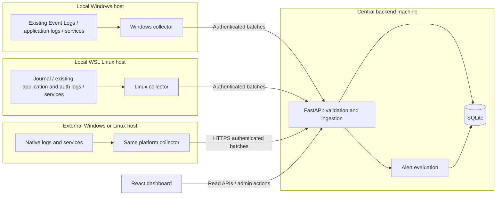

# ServerPulse - High-Level Design

Status: Proposed architecture; not a description of completed functionality.

## 1. Purpose

ServerPulse is a college-project monitoring dashboard that collects Windows and
Linux logs, tracks selected services, and displays alerts in one place.

Development starts with the local Windows computer and a local WSL distribution.
The same architecture must support external Windows and Linux servers without a
separate collection mechanism or a database change for every new machine.

### Scope

- Existing system, application, and available security/authentication logs.
- Optional Linux audit logs where the environment supports them.
- Selected Windows and Linux service states and state-change history.
- Host connectivity, source collection status, log search, and basic alerts.
- Local and remote hosts using the same ingestion APIs.

### Outside the initial scope

- Enterprise-scale ingestion, distributed databases, and message brokers.
- A full SIEM, anomaly detection, or automatic service remediation.
- Remote command execution, SSH/WinRM polling, or server credential storage.
- Email/SMS notifications, multi-tenant access, and advanced user roles.

## 2. Design decisions

| Area | Decision |
| --- | --- |
| Frontend | Existing React and TypeScript application |
| Backend | Existing Python/FastAPI application |
| Central database | SQLite on the backend machine's local disk |
| Collection | Lightweight Python collector running on each monitored host |
| Scheduling | Collectors poll locally, then push batches to the backend |
| Platform access | PowerShell on Windows; journalctl, systemctl, and files on Linux |
| Deployment | One backend instance; Windows and WSL are the first two hosts |
| External hosts | Same collector with a reachable HTTPS backend URL |
| Credentials | Separate per-host collector tokens; separate administrator credential |
| Live updates | Dashboard polls APIs initially; no WebSocket requirement |

No separate collector framework, cloud service, Docker deployment, or database
server is required. A collector can run in a terminal during development and later
under Task Scheduler or a systemd service.

## 3. Architecture

Only the backend opens the central SQLite database. Collectors never connect to
it directly. WSL is registered as a separate Linux host even though it runs on the
same physical computer.

## 4. Components and responsibilities

### 4.1 Collector

- Read configured sources using platform-specific adapters.
- Convert native records to the common event format.
- Poll selected services and report collection failures explicitly.
- Maintain source checkpoints and a small persistent pending-batch spool.
- Send logs, service observations, source status, and heartbeats to FastAPI.
- Retry transient delivery failures without losing batch identity.

Share scheduling, normalization, transport, configuration, and retry code between
platforms. Keep Windows and Linux extraction code separate.

Collector configuration contains the backend URL, host ID, token reference,
enabled source IDs, service IDs, and polling intervals. Secrets must not be
committed to Git or included in diagnostic logs.

### 4.2 Backend

- Authenticate collectors and validate their ownership of sources and services.
- Validate batch sizes, event fields, timestamps, and state values.
- Store normalized events, latest service observations, and transition history.
- Deduplicate retries and track host/source freshness.
- Evaluate simple alert rules and expose paginated query APIs.
- Provide administrator actions for host registration and alert acknowledgement.

### 4.3 Dashboard

- Overview: registered hosts, fresh/stale collectors, service issues, active alerts.
- Hosts: platform, connectivity, latest heartbeat, and per-source errors.
- Logs: host, category, severity, source, service where available, keyword, and time filters.
- Services: latest observed state, observation age, and transition history.
- Alerts: rule, affected host/source/service, evidence, and acknowledgement.

Display empty results separately from collection errors. Do not present a stale
observation as a current healthy state.

## 5. Log sources and extraction

| Category | Windows | Linux / WSL |
| --- | --- | --- |
| System | System Event Log using Get-WinEvent | systemd journal, where available |
| Application | Application Event Log from installed software; existing application log files where available | Existing installed-application journal records or log files |
| Security/authentication | Security Event Log | Authentication-related journal records or configured auth log file |
| Audit | Security events enabled by audit policy | auditd records only after verifying environment support |

### Windows considerations

- Read System and Application channels first.
- Security channel access may require elevated privileges or delegated permissions.
- Audit events depend on the machine's enabled audit policies.
- Query incrementally by channel and record ID, with bounded batch sizes.
- Detect channel clearing/reset and record a collection-gap warning.

### Linux and WSL considerations

- Verify systemd/journald availability before enabling journal collection.
- Read journal records as JSON and resume using journal cursors.
- WSL networking, logging persistence, and systemd availability depend on configuration.
- Authentication files such as `/var/log/auth.log` are not guaranteed to exist.
- Do not assume auditd works just because a distribution is Linux or systemd is enabled.
- Report unsupported or permission-denied sources as unavailable; do not fabricate records.
- Configure non-overlapping journal/file selection where possible to avoid collecting
  the same event twice through different sources.

### Existing application logs

Collect records already produced by installed software; no custom application,
demo log generator, or synthetic application file is required. On Windows, start
with the Application Event Log. On Linux/WSL, discover installed applications
that write to journald or existing files, such as a package manager's logs.

Enable only sources that actually exist and have readable, documented formats.
An application need not be running now to have historical records. If WSL has no
suitable application source, show that limitation rather than generating events
to fill the dashboard. Use configured source/provider mappings to distinguish
application records from system and authentication records in a shared journal.

## 6. Collection and delivery flow

Suggested starting defaults, to be tuned during testing:

| Activity | Initial setting |
| --- | --- |
| Log polling | Every 10 seconds |
| Service polling | Every 10 seconds |
| Heartbeat | Every 15 seconds |
| Host stale threshold | 60 seconds without a heartbeat |
| Dashboard refresh | Every 10 seconds |
| Ingestion batch | At most 200 records, also subject to a request byte-size limit |
| First collection | Bounded recent history, for example the last 15 minutes |

These are configuration defaults, not measured performance guarantees.

### Reliable batch delivery

1. Read records after the last acknowledged checkpoint.
2. Normalize and persist the pending batch locally before sending it.
3. Send the batch with a stable batch ID and stable per-record identities.
4. Backend validates the whole batch and commits storage and related alert updates
   in one short transaction.
5. Backend acknowledges only after the transaction commits.
6. Collector persists the new acknowledged checkpoint, then removes the pending batch.

A timeout after commit causes a retry, not data loss. Backend uniqueness constraints
must prevent duplicate events, transitions, or alerts. This is at-least-once delivery
with idempotent storage, not a claim of exactly-once transport.

Keep one ordered service-observation batch in flight per collector. Include a
persistent observation sequence so delayed/replayed observations cannot overwrite
newer service state.

Retry network failures, rate limits, and transient server errors using bounded
exponential backoff. Authentication and validation failures require a visible
configuration/error state rather than endless rapid retries.

The spool must have a documented size limit. On exhaustion, pause reading and
report the problem; do not silently discard pending batches. Source retention or
rotation may still cause a gap during long outages, which must be recorded.

### Source checkpoints

| Source | Resume identity |
| --- | --- |
| Windows Event Log | Host/source, channel generation, and record ID |
| Linux journal | Journal cursor |
| File | File generation/identity and byte offset |

Windows record IDs alone are insufficient after a channel is cleared. File offsets
alone are insufficient after rotation or truncation. Invalid checkpoints trigger
a visible gap warning and a bounded recovery read, not a silent full-history scan.
Backend checkpoint metadata is an acknowledged progress mirror; collector-local
state controls resumption. Never update one ahead of durable event storage.

## 7. Data model

The [SQLite schema](database-schema.md) defines the proposed tables and constraints
for this architecture. It supports local and external hosts, existing log sources,
host-scoped credentials, acknowledged checkpoints, and ingestion receipts. It is
a design document, not an applied database migration.

Required logical entities:

| Entity | Responsibility |
| --- | --- |
| Hosts | Stable ID, name, platform, deployment type, enabled flag, heartbeat |
| Collector credentials | Host binding, token digest, enabled/revoked status |
| Log sources | Host-owned source configuration, category, status, acknowledged progress |
| Log events | Normalized records, native details, stable deduplication identity |
| Monitored services | Host-owned service configuration and latest accepted observation |
| Service state changes | Append-only transitions and their observation times |
| Alert rules | Service-failure and repeated-error conditions |
| Alerts | Active/history state, evidence, acknowledgement, resolution times |
| Ingestion receipts | Batch identity and outcome for idempotent retries |

### Common event fields

`host_id`, `source_id`, `source_record_id`, `category`, `occurred_at`,
`collected_at`, `received_at`, `severity`, `message`, optional `service_id`,
native event ID/provider, timestamp quality, and optional original fields.

The backend derives the authorized host from the token; it does not trust a
payload's host ID. Source and service IDs must belong to that host.

Store timestamps in UTC. Preserve native severity/details while mapping display
severity to `debug`, `info`, `warning`, `error`, or `critical`, with `unknown`
for unmapped values rather than silently treating them as informational. Missing/invalid native
timestamps need an explicit quality marker if a fallback timestamp is used.

### SQLite usage

- Enable foreign keys for every connection and use schema migrations.
- Use WAL mode, a bounded busy timeout, and short write transactions.
- Start with one backend worker; SQLite still permits only one writer at a time.
- Index source/time, severity/time, and host/source lookup paths.
- Use pagination and bounded time ranges for log queries.
- Configure retention, for example 30 days, and delete expired events in small batches.
- Back up using SQLite's backup facilities rather than copying only a live database file.

## 8. Proposed API boundaries

Route names are provisional; detailed request/response contracts follow in low-level design.

| API | Access | Purpose |
| --- | --- | --- |
| `GET /health` | Minimal public response | Backend process liveness, not monitored-host health |
| `POST /api/hosts` | Administrator | Register host and provision its initial credential |
| `GET /api/hosts` | Dashboard/admin | List hosts and connectivity |
| `POST /api/hosts/{id}/credentials/rotate` | Administrator | Rotate/revoke collector access |
| `PUT /api/hosts/{id}/configuration` | Administrator | Configure allowed sources and services |
| `GET /api/collector/configuration` | Collector | Read its own host configuration |
| `POST /api/ingest/logs` | Collector | Submit a bounded log batch |
| `POST /api/ingest/services` | Collector | Submit ordered service observations |
| `POST /api/ingest/heartbeat` | Collector | Report connectivity and source/spool status |
| `GET /api/logs` | Dashboard/admin | Paginated filtered logs |
| `GET /api/services` | Dashboard/admin | Latest states and freshness |
| `GET /api/services/{id}/history` | Dashboard/admin | Paginated transitions |
| `GET /api/alerts` | Dashboard/admin | Alert list/history |
| `POST /api/alerts/{id}/acknowledge` | Administrator | Acknowledge an alert |
| `GET /api/dashboard/summary` | Dashboard/admin | Overview counts using the same freshness rules |

Ingestion responses distinguish committed acceptance from validation/authentication
failure. Duplicate retries are acknowledged only when their original committed
outcome can be established. Query APIs never return an empty success response to
hide database or collection failures.

## 9. Service health and alerts

Keep these independent:

- **Collector connectivity:** recently seen, stale/offline, or never seen.
- **Collection status:** successful, unavailable, or error for each source/check.
- **Service state:** running, stopped, failed, paused, transitional, or unknown,
  with native state and last observation time retained.

A missed heartbeat does not mean every service stopped. A permission error does
not prove service failure. Linux `failed` is distinct from an inactive service.

Initial rules:

1. **Service failure:** an enabled monitored service expected to run is observed
   stopped or failed. Alert on the first confirmed unhealthy observation as well
   as later transitions. Resolve on confirmed recovery.
2. **Error burst:** at least N unique error/critical records from one configured
   source within M minutes. Count event occurrence times, not delivery attempts.

Evaluate burst windows affected by newly inserted events, including late arrivals.
Backfilled events may create a historical alert labelled with its event window;
they must not be presented as a current incident. Resolve a current burst when
its rolling window falls below the threshold.

Keep at most one unresolved alert per rule/target. Acknowledgement does not mean
recovery. Repeated polls or retried batches must not create repeated active alerts.
A small periodic backend task reevaluates time-based resolution even when no new
events arrive; serialize its writes with normal backend database access.

## 10. Deployment and security

### Local development

- FastAPI and SQLite run on the Windows development computer.
- Windows collector runs locally; Linux collector runs inside WSL.
- React connects to FastAPI using a configured API URL.
- Windows localhost can use loopback; verify WSL-to-Windows connectivity separately.
  Depending on WSL networking mode, Windows localhost may not be reachable directly.
- Bind only to required interfaces and configure firewall rules deliberately.

### External servers

- Use the same collectors with the backend's reachable address.
- Prefer a LAN or private network; public exposure is not required for the project.
- External collectors initiate outbound HTTPS connections; no inbound collector port.
- Terminate TLS at a simple reverse proxy or HTTPS-enabled server.
- Keep SQLite private on the backend; never expose or network-share the database.

### Minimum access controls

- Local plaintext HTTP is for isolated development only; remote traffic uses HTTPS.
- Each collector has a separate revocable token scoped to one host's ingestion.
- Store only credential digests centrally; keep collector secrets in protected
  local configuration and transmit them only with TLS outside isolated development.
- Collector tokens cannot read other hosts' data or perform administrator actions.
- Use a separate simple administrator login/token for dashboard and configuration APIs.
  Multi-user roles can wait, but remote deployment cannot defer authentication.
- Do not persist administrator secrets in browser local storage; use an in-memory
  credential for a simple prototype or a protected session if login is implemented.
- Restrict CORS origins, request sizes, and ingestion rate.
- Run collectors with the minimum permissions required by enabled sources.
- Never execute commands supplied through log content or arbitrary dashboard inputs.
- Treat log messages as untrusted text; render without raw HTML.
- Logs can contain sensitive data. Limit sources, retention, file permissions, and
  raw-payload storage; do not use real sensitive logs in submitted demo evidence.

## 11. Implementation milestones

| Milestone | Deliverable and completion check |
| --- | --- |
| 1. Foundation | SQLite migrations, host registration, scoped tokens, and batch ingestion; cross-host submissions rejected |
| 2. Windows logs | System/Application collection displayed in React; restart/retry does not duplicate records |
| 3. WSL logs | Separate Linux host with existing journal/application/authentication records where available; unsupported sources visible |
| 4. Health monitoring | Configured Windows/Linux service observations, heartbeat freshness, and transition history |
| 5. Alerts and search | Service failure/recovery, repeated-error rules, acknowledgement, and paginated filters |
| 6. Remote verification | Same collector on another machine successfully sends authenticated HTTPS batches |
| 7. Demo and documentation | Setup guide, failure/recovery evidence, retention/backup instructions, and known limitations |

Windows and WSL testing verifies the collection adapters, not external network
support by itself. A separate machine/VM reaching the backend is required to verify
the remote milestone.

## 12. Verification scenarios

- Collect actual Windows System/Application records and WSL journal records where available.
- Read existing application records from installed software on both platforms
  where available; verify category/provider filters without generating custom logs.
- Access a restricted source and verify an explicit unavailable status.
- Stop/restart only a dedicated test service; verify one incident and recovery.
- Stop a collector; verify stale connectivity without fabricated stopped services.
- Restart collector/backend and retry an acknowledged batch; verify no duplicates.
- Disconnect the backend temporarily; verify spool replay and checkpoint correctness.
- Test file rotation, channel reset, invalid journal cursor, and spool exhaustion.
- Submit an invalid token, foreign source ID, oversized batch, and malformed timestamp.
- Deliver out-of-order service observations and late log events; verify defined behavior.
- Verify acknowledgement differs from resolution and that burst alerts expire without new logs.
- Verify pagination, UTC/time-range filters, retention, and a restored SQLite backup.

## 13. Limitations and future work

Polling introduces detection delay. WSL stops collecting when its distribution is
not running, and its journal/audit capabilities may differ from a full Linux server.
Source retention can remove unread logs during prolonged outages. SQLite and one
backend instance target a small demonstration, not high-volume enterprise workloads.

Future extensions include a full Linux VM for audit testing, richer user roles,
notification delivery, installer packaging, and PostgreSQL only if measured workload
requires it. These are not prerequisites for the initial project.
