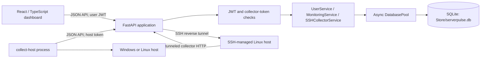
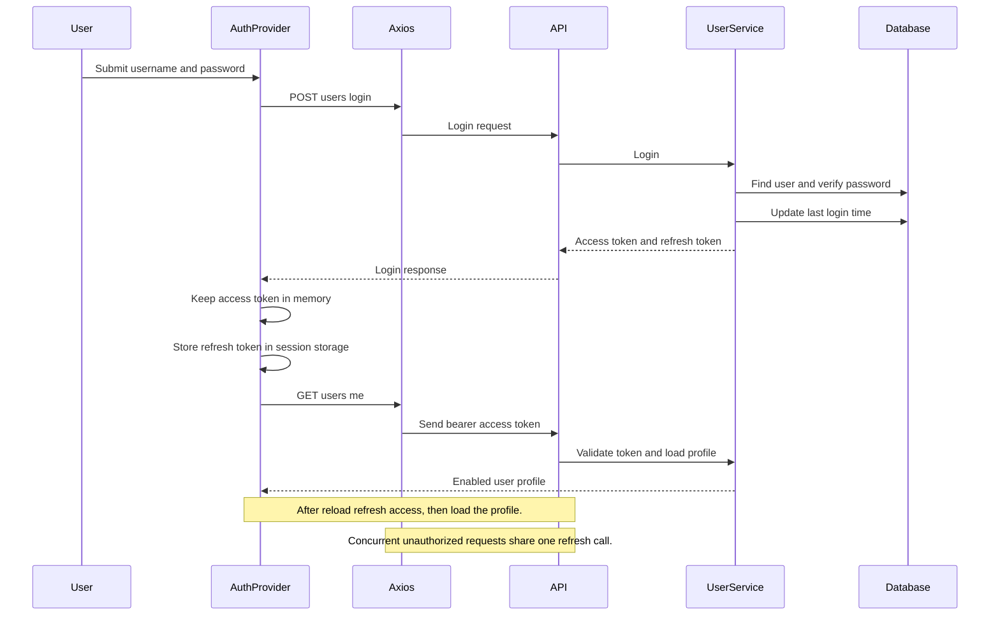
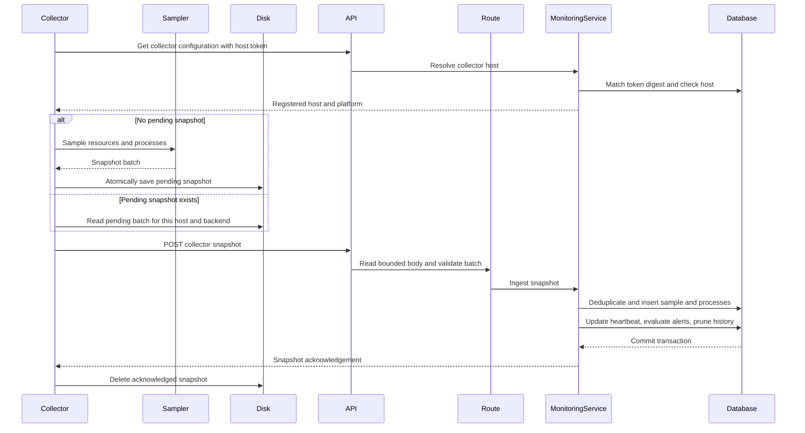
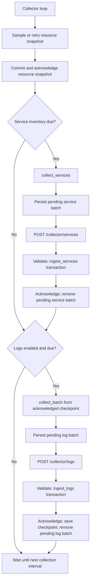

# ServerPulse - Low-Level Design and Function Flows

Updated: 2026-11-14. This document describes the current implementation in the
repository, not every table or future behavior in the design. The [HLD](HLD.md)
describes the system boundaries; the [database design](../db/database-schema.md)
describes the complete schema and its planned as well as implemented parts.

## 1. Runtime structure

The browser and collectors call FastAPI routes. Route handlers validate
transport-level input and delegate domain work to services. Services use the
single asynchronous SQLite pool owned by the FastAPI lifespan. Collectors never
open the central database. Database migrations are an explicit operator action;
server startup opens the pool but does not migrate the schema.

## 2. Module and function responsibilities

| Layer | Module / principal functions | Responsibility |
| --- | --- | --- |
| Application | `app.main.lifespan`, `app.main.app` | Open the database pool, restore SSH supervisors, configure middleware, and register routers; shut down supervisors and pool in lifecycle order. |
| HTTP routes | `app.api.routes.users`, `hosts`, `collector`, `notifications` | Parse requests, apply dependencies, map service results to HTTP responses. `routes.__init__` combines routers. |
| User authentication | `UserService.create_user`, `login`, `refresh`; `JWTService.create_*`, `validate_*`; `get_current_user` | Hash and verify passwords, issue/validate typed JWTs, enforce enabled-account and role checks at protected endpoints. |
| Host and monitoring domain | `MonitoringService.register`, `update`, `rotate_token`, `collector_host`, `ingest`, `ingest_logs`, `ingest_services`, `latest`, `metrics`, `processes`, `process_history` | Enforce ownership, issue host credentials, atomically persist telemetry, evaluate machine metric rules, and serve host-scoped queries. |
| Local collector control | `LocalCollectorManager.start`, `stop`, `status`; `MonitoringService.start_local_collector` | Run or stop a local `app.collector` child process for localhost hosts. |
| SSH collector control | `SSHCollectorService.scan`, `install`, `start`, `stop`, `status`; `SSHSupervisorManager` | Verify a Linux SSH target, deploy the collector, retain encrypted SSH credentials, create a reverse tunnel, and reconnect while desired state is running. |
| Collection | `ResourceSampler.sample`, `collect_batch`, `collect_services`, `app.collector.main` | Read local resources, processes, supported logs and service inventory; persist pending batches and deliver them. |
| Persistence | `DatabasePool.connection`, `transaction`, `fetch_one`, `fetch_all`, `execute` | Borrow async SQLite connections, use explicit transactions, and return connections to the shared pool. |
| Browser API | `src/api/client.ts`, `endpoints.ts`, `monitoring.ts` | Provide typed API calls, attach access tokens, serialize concurrent refresh attempts, and map errors. |
| Browser UI | `AuthProvider`; `MachinesMonitoring` and its panels | Maintain the signed-in session, poll host data, render monitoring and source states, and issue host/collector actions. |

## 3. Main request contracts

| Operation | Route | Authentication | Main implementation |
| --- | --- | --- | --- |
| Register / sign in / refresh | `POST /users/create`, `/users/login`, `/users/refresh` | Public | `UserService`; registration creates regular users only. |
| Account and admin functions | `GET/PATCH /users/me`, `POST /users/me/password`, `GET /users`, `POST /users/admins` | User JWT; admin routes recheck enabled admin status | `UserService` |
| Host directory and settings | `GET/POST /hosts`, `PATCH /hosts/{id}`, `POST /hosts/{id}/credentials/rotate` | Enabled user; host visibility is owner-scoped unless admin | `MonitoringService` |
| Resource ingestion | `GET /collector/configuration`, `POST /collector/snapshots` | Host collector token | `MonitoringService.collector_host`, `.ingest` |
| Log/service ingestion | `POST /collector/logs`, `/collector/services` | Host collector token | `.ingest_logs`, `.ingest_services` |
| Monitoring queries | `GET /hosts/{id}/monitoring`, `/metrics`, `/processes`, `/process-history` | Enabled user, then host ownership check | `MonitoringService` |
| Logs and inventory | `GET /hosts/{id}/logs`, `/log-sources`, `/services` | Enabled user, then host ownership check | `MonitoringService` |
| Machine metric alerts | `GET/POST /hosts/{id}/alert-rules`, `PUT/DELETE /hosts/{id}/alert-rules/{rule_id}`, `GET /hosts/{id}/alerts` | Enabled user, then host ownership check | `MonitoringService` |
| Local collector control | `GET/POST /hosts/{id}/local-collector[/start|/stop]` | Enabled user, then host ownership check | `LocalCollectorManager` via `MonitoringService` |
| SSH collector control | `POST /hosts/ssh/scan`, `POST /hosts/ssh`, `GET/POST /hosts/{id}/ssh-collector[/start|/stop]` | Scan/install require non-admin owner; host actions require visible host | `SSHCollectorService` |

Collector request bodies are streamed and size-limited before Pydantic validation:
16 MiB for resource snapshots and 4 MiB each for log and service batches. Pydantic
schemas reject unknown fields and validate platform, timestamp, count, and enum
constraints. User and collector tokens are separate credentials.

## 4. User sign-in and browser session flow

`UserService.login` verifies the password even for a missing username, then
rejects invalid credentials or disabled accounts. Password hashing and
verification run in worker threads so they do not block the event loop. JWTs
contain a string user ID subject, token type, issue time, and expiration.
Refresh tokens are not stored server-side. Sign-out clears browser tokens but
does not revoke issued JWTs.

`get_current_user` validates the access JWT. Routes that need current account
availability or a role use additional `UserService` checks; the generic JWT
dependency alone does not query whether an account has since been disabled.
The host `Viewer` dependency does recheck that the user is enabled and derives
host ownership/admin scope.

## 5. Resource and process collection flow

`ResourceSampler.sample` takes a one-second host CPU sample, reads physical
memory, then iterates visible processes. Process CPU is a delta keyed by
`(pid, create_time)` and is unknown until a prior observation exists. A process
that disappears is counted as vanished; permission failures preserve a partial
row and increment the denied count. The collector does not collect command
lines, environment variables, or usernames.

`app.collector.main` checks backend URL/security options and token, fetches the
registered host configuration, and rejects platform mismatch. It reuses a
pending snapshot rather than resampling during delivery failure. The state file
is written through a temporary file, flushed, and atomically replaced. Network,
rate-limit, and server failures retry with bounded exponential delay; permanent
resource-ingestion 4xx errors stop visibly with pending data retained. Sampling
and delivery do not overlap.

`MonitoringService.ingest` rechecks platform and computes a canonical payload
digest. A repeated `(host_id, batch_id)` with the same digest returns the prior
receipt; reuse with different content returns 409. A new accepted batch is one
transaction: resource sample, process rows, receipt, heartbeat, alert evaluation,
and retention pruning commit together. Runtime, long-running, and Linux zombie
classifications are derived server-side. History query bounds are 24 hours;
expired samples are removed on the host's next accepted snapshot, with resource
receipts retained seven days.

### Resource query flow

1. `require_viewer` validates the access token, reloads the enabled account, and
   creates a `HostActor`.
2. `MonitoringService.get_host` applies owner scope (admins can see all hosts);
   out-of-scope and absent hosts both return 404.
3. `latest` returns the last sample without fabricating a zero sample.
   `metrics` returns up to 500 observations from the last 24 hours.
4. `processes` selects the latest snapshot, applies name/long-running/zombie
   filters and bounded sort/pagination, and returns `total` plus rows.
5. `process_history` requires timezone-qualified creation time and queries by
   host, PID, and creation time, not PID alone.
6. The UI refreshes host, latest, metrics, and process data at nominal
   ten-second intervals without overlapping a polling cycle. It retains the
   previous display on refresh errors and labels stale data and partial visibility.

## 6. Log and service collection flow

After a successful resource delivery, the collector attempts service inventory
on a five-minute cadence and logs on a one-minute cadence when `--logs` is set.
Service collection enumerates Windows services with PowerShell or Linux service
units with `systemctl`; log collection reads Windows System/Application Event
Logs or Linux journald. Unsupported and permission-limited sources are reported
as `unavailable` or `error`, rather than represented as empty successful data.

For logs, `collect_batch` uses Windows EventRecordID or journald cursor values.
The collector stores one pending batch and advances its local checkpoint only
after an acknowledgement. Ingestion upserts source status, inserts deduplicated
events, writes a receipt, updates the host heartbeat, and prunes logs older than
two days in one transaction. A matching retry returns its saved receipt.
Journald `.service` unit names and Windows Service Control Manager references are
linked to inventory rows when available.

For services, `collect_services` normalizes native state to running, stopped,
failed, paused, transitional, or unknown. `ingest_services` idempotently accepts
the batch and upserts current inventory state, receipt, and heartbeat. It
increments `last_observation_sequence` for existing inventory entries.

Current boundaries: the log adapter does not read Windows Security logs or Linux
application/authentication files. The service collector sends a complete
inventory; there is no configured per-service polling set. Although the schema
has `service_state_changes`, current ingestion updates latest state but does not
insert transition history. Log/service alert rules are not evaluated by these
ingestion paths.

## 7. Machine metric alert flow

Machine metric rules support host CPU, memory, long-running count, Linux zombie
count, and named-process CPU, memory, or count. The rule editor validates
thresholds and process-name requirements. Up to 50 machine rules can be stored
per host.

1. On a new resource snapshot, `MonitoringService.ingest` calls
   `_evaluate_alert_rules` within the same write transaction.
2. Each rule reads the latest sample's metric. Process metrics sum or count all
   case-insensitive name matches.
3. A breach must remain continuous for `sustained_minutes`; `_breach_started_at`
   finds the first breaching sample after the last clear sample.
4. A qualifying breach inserts one open alert and a host-owner notification.
   Further samples update its value.
5. A non-breaching sample resolves the open alert and creates a resolution
   notification. A partial unique index prevents multiple unresolved alerts for
   one rule.

There is currently no alert acknowledgement endpoint or log-burst/service-state
evaluation, despite schema support for those future rule types. The UI exposes
machine metric rules and their alert history.

## 8. Host registration and collector credentials

1. An enabled signed-in user submits host name, platform, deployment type, and
   threshold. WSL registrations must be Linux and include a distribution name.
2. `MonitoringService.register` checks the owner's duplicate-host rules inside a
   write transaction, inserts the host, generates a random collector token, and
   stores only its SHA-256 digest.
3. The raw token is returned once and displayed in the UI dialog.
4. On every collector request, `collector_host` hashes the presented token and
   resolves it to an unrevoked credential for an enabled host. The token-bound
   host, not request payload, determines the target host.
5. Rotation revokes all current credentials and inserts a fresh digest. For a
   localhost collector, starting it also rotates the token before launching the
   child process.

Host visibility is owner-scoped for regular users and global for admins.
Administrators may register or update hosts and rotate credentials. SSH
installation is restricted to regular users. Admin changes to another owner's
settings or credentials generate an in-app notification.

## 9. SSH-managed Linux collector flow

`SSHCollectorService.scan` fetches the server host key and returns its
fingerprint for explicit confirmation in the UI. `install` fetches the key again
and rejects a changed fingerprint, opens SSH with that pinned key, verifies Linux
and remote Python 3.11+, registers an external Linux host, bundles collector
files, creates a remote virtual environment, writes the collector token with
restrictive permissions, and starts the remote collector.

The backend stores the SSH secret encrypted and starts one
`SSHSupervisorManager` task for the host. The supervisor reconnects with bounded
backoff, restarts the remote collector if necessary, and forwards the chosen
remote loopback port to the backend port. Collector HTTP traffic crosses this
SSH reverse tunnel. `start` rotates the collector token and restarts the remote
process; `stop` persists desired state as stopped and attempts remote shutdown.
If the remote is unreachable, the status reports that the collector may still be
running remotely; the next reachable stop can finish the shutdown.

On backend startup, `SSHSupervisorManager.restore` resumes hosts whose persisted
desired state is running. On shutdown it cancels supervisor tasks. This feature
requires SSH connectivity and remote host prerequisites; it does not imply
external-host deployment verification.

## 10. Persistence and operational invariants

- One `DatabasePool` is created in the app lifespan (five connections by
  default); each connection enables foreign keys and WAL. Transactions use
  `BEGIN IMMEDIATE`, commit on success, and roll back on failure/cancellation.
- The default database is `Store/serverpulse.db`. Apply migrations explicitly
  using `Backend/db/migrate.py`.
- Monitoring receipts make snapshot retries idempotent independently of log and
  service receipts. Receipt payload digests detect conflicting batch-ID reuse.
- Heartbeat time is backend receipt time. Hosts become offline after 60 seconds
  without an accepted collector batch; sample age remains separate from
  connectivity.
- SQLite is a single-writer database intended for a small lab. Keep it on local
  backend storage and use the SQLite backup API for live backups.

## 11. Implementation coverage

| Capability | Current implementation |
| --- | --- |
| User accounts and JWT auth | Implemented; no server-side JWT revocation. |
| Resource/process collection and queries | Implemented for collector-supported Windows/Linux hosts; platform deployment verification is separate. |
| Windows System/Application and Linux journald logs | Implemented with source status, deduplication, checkpointing, filtering, and UI. Other log categories/sources remain unsupported. |
| Service inventory and current state | Implemented for Windows Services and systemd units; transition history and per-service selection are not implemented. |
| Machine metric alerts | Implemented and evaluated on resource ingestion; service failure and log-burst evaluation and acknowledgement are not implemented. |
| Local and SSH-managed collector lifecycle | Implemented; SSH setup is for Linux. |
| Reports and exports | Not implemented. |

Related references: [user guide](../../guides/user-guide.md),
[admin guide](../../guides/admin-guide.md), [backend guide](../../../Backend/README.md),
and [frontend guide](../../../Frontend/README.md).
